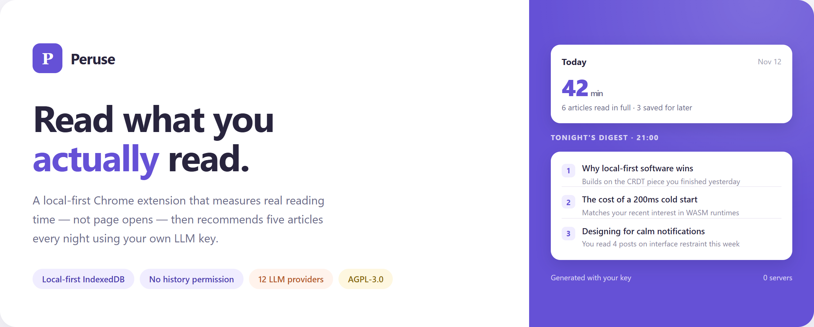
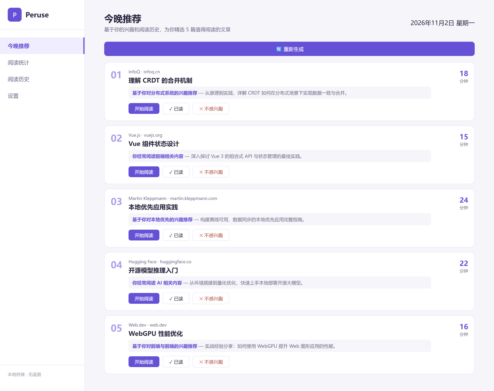
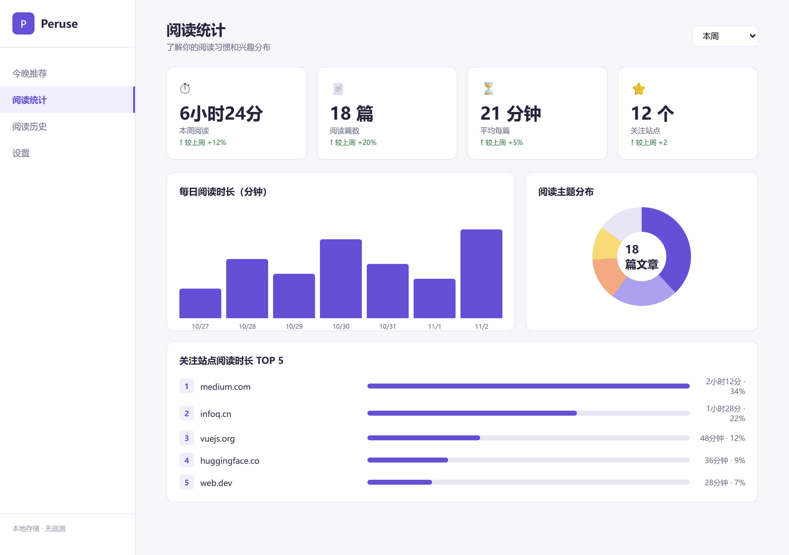
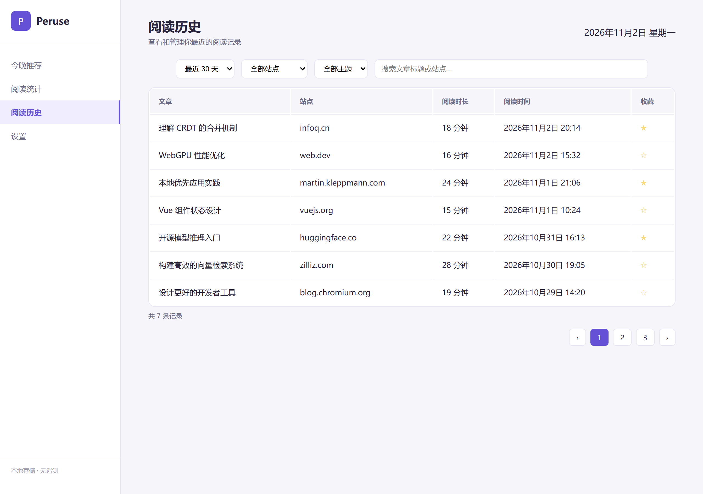
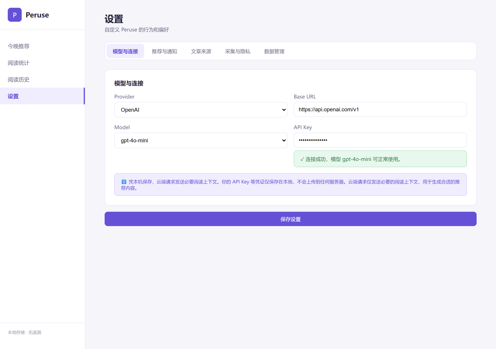
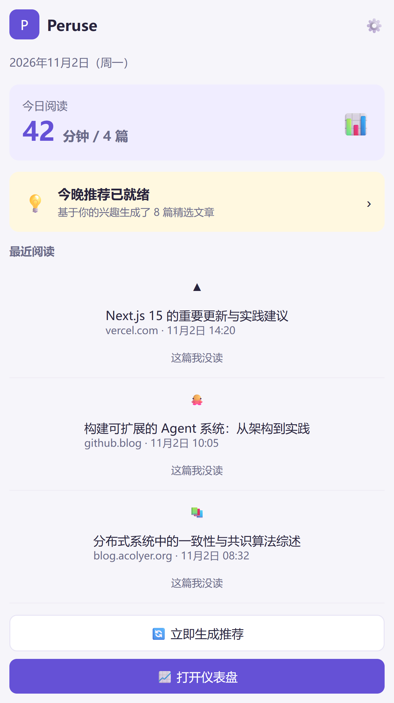
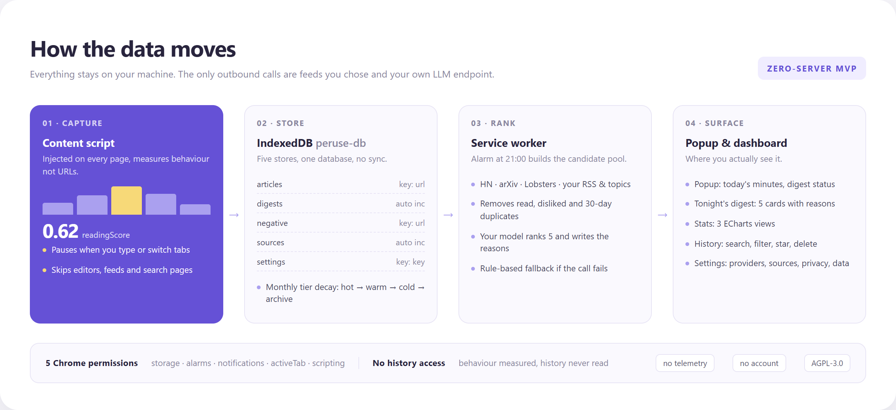

# Peruse

**A local-first Chrome extension that records the articles you actually finish reading — then recommends five new ones every night using your own LLM key.**



[](https://developer.chrome.com/docs/extensions/develop/migrate)
[](https://vuejs.org/)
[](https://wxt.dev/)
[](./tests)
[](./LICENSE)

Every reading record stays in your own IndexedDB. There is no Peruse server, no account, no telemetry, and the extension never asks for the `chrome.history` permission.

> **Status:** early MVP. It builds, loads unpacked, and works end to end; it is not yet published on the Chrome Web Store. UI strings are currently Chinese — internationalisation is on the roadmap.

---

## Why this exists

Browser history is a terrible proxy for reading. Twenty tabs opened, three read, seventeen skimmed for two seconds — all recorded identically. "Read later" apps are worse: they only know what you *saved*, never what you *finished*.

Pocket shut down in July 2025 and left a gap. Peruse fills it with a different premise:

| | Pocket / Instapaper | Browser history | **Peruse** |
|---|---|---|---|
| How it records | You save URLs manually | Records every visit | Measures reading behaviour, passively |
| What it knows | That you saved something | That a page opened | How long you actually read it |
| Recommendations | Editor picks | None | Your own LLM, ranked on your real history |
| Where data lives | Their servers | Your browser | Your IndexedDB only |
| Account | Required | None | None |

---

## Screenshots

*Design reference — the shipped UI follows these layouts.*





| | |
|---|---|
|  |  |



---

## How it works



### 1. Capture — `content.ts`

A content script runs on every page and measures behaviour instead of URLs. Four weighted signals become a `readingScore` between 0 and 1:

| Signal | Weight | What it means |
|---|---|---|
| `visibleTime` | 30% | Seconds the tab was actually in the foreground |
| `scrollDepth` | 25% | How far down the page you got |
| `selection` | 20% | Text you highlighted (a strong engagement signal) |
| `scrollRhythm` | 25% | 3–8 s between scrolls reads as normal reading, rapid bursts read as skimming |

Anything above **0.3** is written to storage; below that it is discarded as a skim.

The timer pauses when you switch tabs, and when you type into an input or textarea — so writing a long GitHub comment never counts as reading. Editor surfaces (Google Docs, Notion, CodePen…) are skipped wholesale, and home pages, search results and social feeds are filtered out by link density, `og:type` and body word count.

### 2. Store — `utils/db.ts`

One IndexedDB database, `peruse-db`, five object stores:

| Store | Key | Holds |
|---|---|---|
| `articles` | `url` | Reading records: title, host, time, score, starred, tier |
| `digests` | auto-increment | Every generated nightly digest |
| `negative` | `url` | Articles you marked "not interested" |
| `sources` | auto-increment | RSS feeds and tracked topics |
| `settings` | `key` | Provider config, schedule, privacy lists |

On the first of each month an `alarms` job decays storage in tiers: `hot` (<30 days, full record) → `warm` (30–90 days, body trimmed) → `cold` (90–180 days, metadata only) → `archive` (>180 days, flagged). **Starred records are never touched.** Above 5,000 records the popup prompts you to export a backup.

### 3. Rank — `background.ts`

1. A `chrome.alarms` job fires at your chosen time (default **21:00**).
2. It assembles a candidate pool: built-in HN / arXiv / Lobsters, RSS feeds discovered on pages you read, feeds and topics you added, plus search terms the model suggests.
3. It removes anything you already read, disliked, or that was pushed in the last 30 days.
4. Your model ranks the pool and writes a per-article reason, in JSON mode, with one retry on parse failure.
5. If the call fails or no model is configured, it falls back to a rule-based ranker (keyword overlap + freshness + source weight).
6. The digest is written to `digests`, status is published to `chrome.storage.local`, and a notification fires — clicking it opens the dashboard.

### 4. Surface — `popup/`, `dashboard/`, `onboarding/`

| View | What you get |
|---|---|
| Popup | Today's minutes, digest status, recent reads, "generate now" |
| Tonight's digest | Five cards with reason, estimated minutes, start / read / not-interested (4 reasons) |
| Reading stats | Weekly minutes, articles finished, avg per article, top sites, 3 ECharts views |
| Reading history | Search, host filter, date range, star, "I didn't read this", delete |
| Settings | Five tabs: model & connection, digest & notifications, sources, capture & privacy, data |

---

## Install (unpacked)

```bash
git clone https://github.com/<your-username>/peruse.git
cd peruse

pnpm install      # no pnpm? use `corepack enable` or `npm i -g pnpm`
pnpm build        # output in .output/chrome-mv3
```

Then:

1. Open `chrome://extensions`
2. Turn on **Developer mode** (top right)
3. Click **Load unpacked** and select `.output/chrome-mv3`
4. On first install the three-step onboarding opens: interest tags → model setup → done

Development loop: `pnpm dev` launches Chrome with the extension loaded and hot-reloads on save.

```bash
pnpm typecheck    # tsc --noEmit
pnpm test         # vitest, 7 suites
pnpm zip          # packaged zip for the Web Store
```

---

## Model configuration

Bring your own key. Twelve providers are preconfigured; Base URL and model name stay editable, and keys are stored per provider.

| Provider | Endpoint | Notes |
|---|---|---|
| OpenAI | `https://api.openai.com/v1` | GPT series |
| Anthropic | `https://api.anthropic.com` | Claude series |
| Google Gemini | `https://generativelanguage.googleapis.com` | Gemini series |
| DeepSeek | `https://api.deepseek.com` | DeepSeek series |
| Zhipu AI | `https://open.bigmodel.cn` | GLM series |
| Kimi | `https://api.moonshot.cn` | Moonshot |
| Qwen | `https://dashscope.aliyuncs.com` | Alibaba DashScope |
| OpenRouter | `https://openrouter.ai/api` | Multi-model router |
| Ollama | `http://localhost:11434/v1` | Local, no key |
| LM Studio | `http://localhost:1234/v1` | Local, no key |
| vLLM | `http://localhost:8000/v1` | Local, no key |
| Custom | any OpenAI-compatible endpoint | Your own |

Local providers hide the API-key field automatically. Pointing Peruse at Ollama gives you a fully offline recommendation loop.

---

## Privacy

### Chrome permissions — five, and `history` is not one of them

| Permission | Used for |
|---|---|
| `storage` | Settings and model config |
| `alarms` | Nightly digest, monthly storage decay |
| `notifications` | "Your digest is ready" |
| `activeTab` / `scripting` | Opening the dashboard, keeping the content script alive |

`host_permissions: <all_urls>` exists only so the capture script can run on any page and so feeds can be fetched.

### Outbound requests

| Domain | Why |
|---|---|
| `hn.algolia.com`, `news.ycombinator.com` | Hacker News front page and keyword search |
| `export.arxiv.org` | arXiv API |
| RSS addresses you add or that are auto-discovered | Candidate articles |
| The one LLM endpoint you configured | Generating recommendations |

There is no `peruse.` domain anywhere in the code. Nothing is sent anywhere you did not choose.

---

## Tech stack

| Layer | Choice |
|---|---|
| Extension framework | WXT 0.19 (MV3, Vite under the hood) |
| UI | Vue 3 + TypeScript, Composition API |
| State | Pinia |
| Charts | ECharts |
| Storage | IndexedDB (no wrapper library) |
| Tests | Vitest + fake-indexeddb |

Deliberate constraint: **no new runtime dependencies.** RSS/Atom is parsed with regex, article extraction is a DOM heuristic. Every dependency in a reading tool is another thing that can phone home.

```
src/
├── entrypoints/
│   ├── background.ts        # alarms, messages, notifications
│   ├── content.ts           # capture + readingScore
│   ├── popup/               # 360px popup
│   ├── dashboard/           # 4 views
│   └── onboarding/          # 3-step first run
├── components/              # DigestView, StatsView, HistoryView, SettingsView, DataLabView
├── stores/                  # Pinia settings store
├── utils/                   # db, llm, sources, digest, reading, settings, status
└── assets/main.css          # design tokens
tests/                       # 7 Vitest suites
docs/images/                 # README images (sources in docs-src/)
```

Structure in detail: [项目结构说明.md](./项目结构说明.md) (Chinese).

---

## Roadmap

- [x] Behaviour-based capture with a 0–1 reading score
- [x] Nightly LLM digest with rule-based fallback
- [x] Dashboard: digest, stats, history, settings
- [x] Tiered local storage with monthly decay
- [x] 12 providers including three local ones
- [ ] English UI and i18n scaffolding
- [ ] Chrome Web Store listing
- [ ] Optional end-to-end encrypted multi-device sync (paid tier)
- [ ] Hosted model proxy for people who don't want to manage keys (paid tier)

The MIT-style "just works" version is the free one. Sync and a hosted proxy are the intended paid features; the local-first core will not be paywalled.

---

## Contributing

Issues and PRs are welcome. Before opening a PR:

```bash
pnpm typecheck && pnpm test && pnpm build
```

Two house rules: `typecheck` and `build` must stay green, and no new runtime dependencies without discussing it in an issue first.

Security reports: see [SECURITY.md](./SECURITY.md).

---

## License

AGPL-3.0-only — see [LICENSE](./LICENSE). If you run a modified version as a network service, you have to publish the source.

**Other languages:** [中文说明](./README.zh-CN.md)
