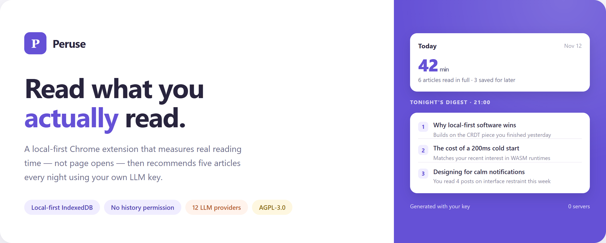
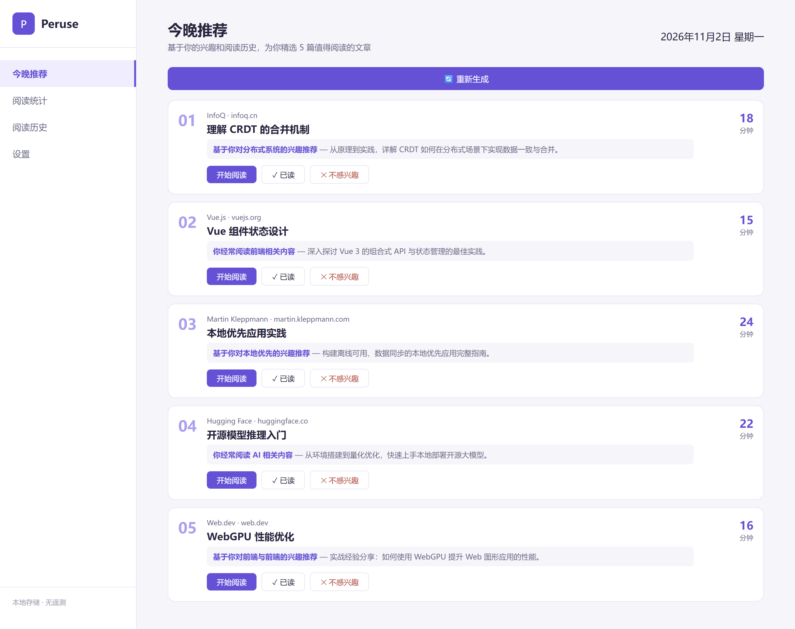
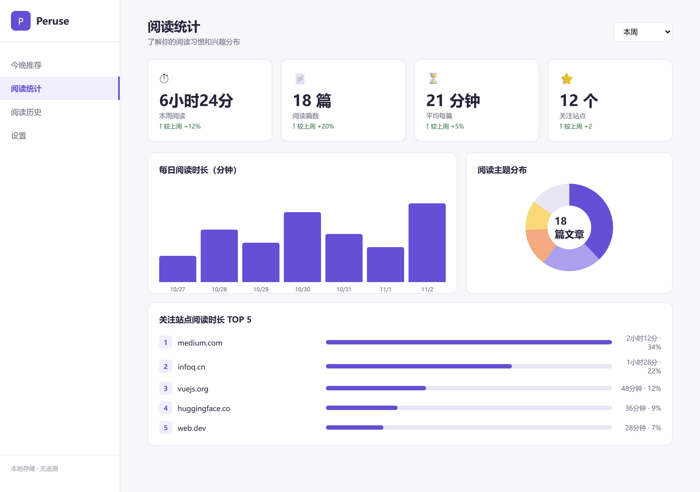
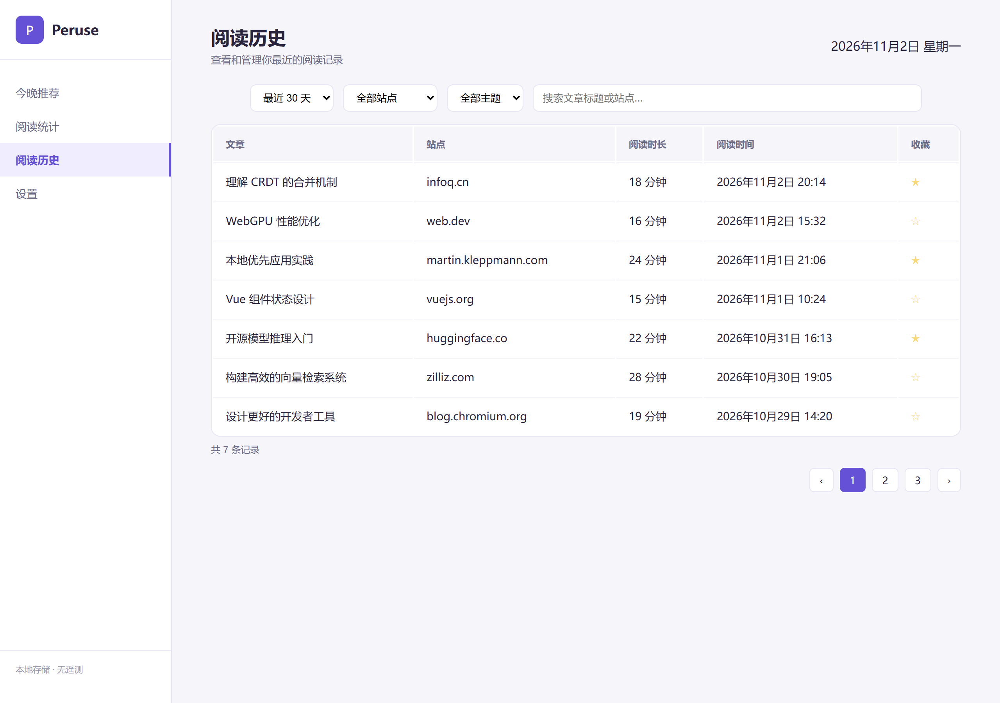
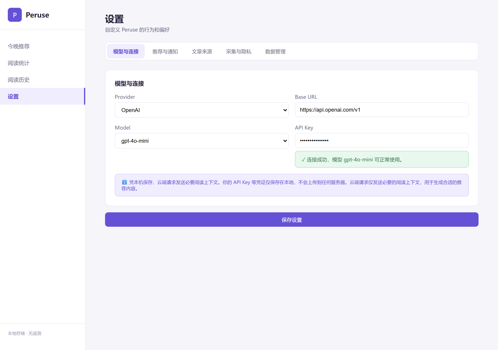
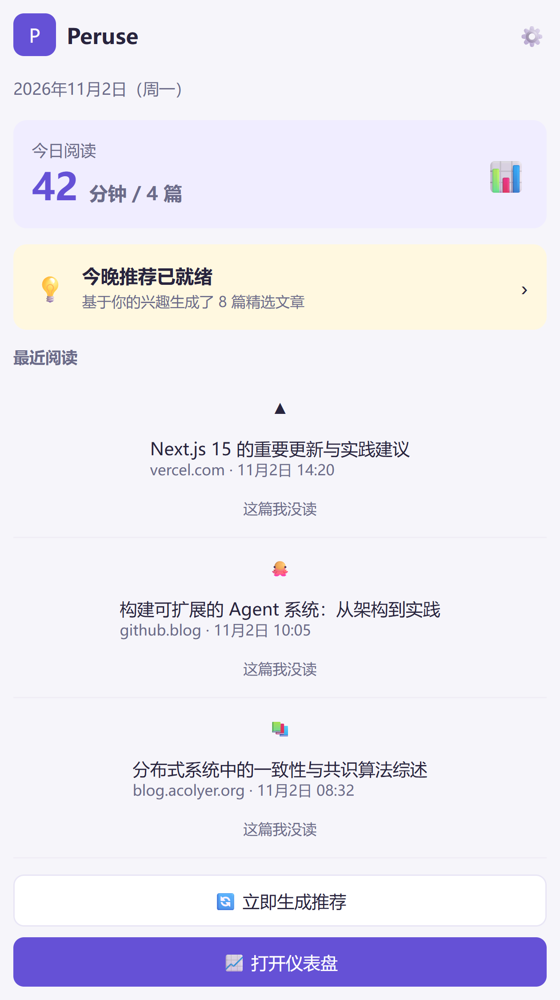
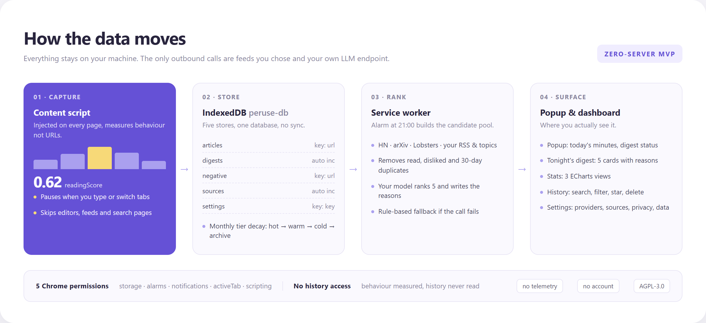

# Peruse

**一个 local-first 的 Chrome 扩展：被动记录你真正读完的文章，每晚用你自己的大模型推荐 5 篇新文章。**



[](https://developer.chrome.com/docs/extensions/develop/migrate)
[](https://vuejs.org/)
[](https://wxt.dev/)
[](./tests)
[](./LICENSE)

所有阅读记录只写入本机 IndexedDB。没有 Peruse 服务器，没有账号，没有遥测，也不申请 `chrome.history` 权限。

> **状态：** 早期 MVP。能构建、能未打包加载、主流程可用；尚未上架 Chrome Web Store。

[English](./README.md) · 中文

---

## 为什么做这个

浏览器历史无法代表阅读。开 20 个 tab，读 3 篇，划走 17 篇，历史里一模一样。「稍后读」更差——只知道你存了什么，不知道你读完了什么。

Pocket 于 2025 年 7 月停运，留下了空位。Peruse 用另一个前提补上：

| | Pocket / Instapaper | 浏览器历史 | **Peruse** |
|---|---|---|---|
| 怎么记 | 你手动存 URL | 记录每次访问 | 被动测量阅读行为 |
| 知道什么 | 你存过 | 页面打开过 | 你实际读了多久 |
| 推荐 | 编辑精选 | 无 | 你自己的模型，按真实阅读记录排序 |
| 数据在哪 | 他们的服务器 | 你的浏览器 | 只有你的 IndexedDB |
| 账号 | 必须 | 无 | 无 |

---

## 界面

*设计参考——实现后的界面沿用这套布局。*





| | |
|---|---|
|  |  |



---

## 数据流



### 1. 采集 — `content.ts`

内容脚本注入每个页面，测行为而不是测 URL。四个加权信号合成 0–1 的 `readingScore`：

| 信号 | 权重 | 含义 |
|---|---|---|
| `visibleTime` | 30% | 页面真正在前台的秒数 |
| `scrollDepth` | 25% | 你滚到多深 |
| `selection` | 20% | 你拖选了什么（强参与信号） |
| `scrollRhythm` | 25% | 3–8 秒一次滚动是正常阅读，快速连滚是划走 |

**> 0.3 才写入**，低于阈值当作划走丢弃。

切到后台、在输入框/评论框打字时暂停计时——写一条长 GitHub 评论不会被算成阅读。Google Docs / Notion / CodePen 等编辑页整页跳过；首页、搜索结果、社交媒体通过链接密度、`og:type`、正文词数过滤掉。

### 2. 存储 — `utils/db.ts`

一个 IndexedDB 数据库 `peruse-db`，五个 store：

| Store | 主键 | 存什么 |
|---|---|---|
| `articles` | `url` | 阅读记录：标题、站点、时长、评分、收藏、层级 |
| `digests` | 自增 | 每份历史推荐 |
| `negative` | `url` | 你标记「不感兴趣」的文章 |
| `sources` | 自增 | RSS 源与追踪主题 |
| `settings` | `key` | 模型配置、推送时间、隐私名单 |

每月 1 日由 `alarms` 执行分层降级：`hot`（<30 天，完整）→ `warm`（30–90 天，裁剪正文）→ `cold`（90–180 天，只留元数据）→ `archive`（>180 天，标记归档）。**收藏永不处理。** 超过 5000 条时 popup 提示导出备份。

### 3. 排序 — `background.ts`

1. `chrome.alarms` 在你设定的时间触发（默认 **21:00**）
2. 组装候选池：内置 HN / arXiv / Lobsters + 你读过的页面上自动发现的 RSS + 你添加的源与主题 + 模型给出的搜索词
3. 剔除已读、负反馈、30 天内已推送的 URL
4. 交给你的模型排序并写推荐理由（JSON 模式，解析失败重试一次）
5. 调用失败或没配模型时，降级为关键词 / 新鲜度 / 来源加权的规则推荐
6. 写入 `digests`，把状态写到 `chrome.storage.local`，发通知——点击打开仪表盘

### 4. 呈现 — `popup/`、`dashboard/`、`onboarding/`

| 视图 | 内容 |
|---|---|
| Popup | 今日分钟数、推荐状态、最近阅读、「立即生成」 |
| 今晚推荐 | 5 张卡片：理由、预计时长、开始阅读 / 已读 / 不感兴趣（4 种原因） |
| 阅读统计 | 本周时长、读完篇数、平均每篇、最常读站点、3 个 ECharts 图表 |
| 阅读历史 | 搜索、站点过滤、时间范围、收藏、「这篇我没读」、删除 |
| 设置 | 五个 tab：模型与连接、推荐与通知、文章来源、采集与隐私、数据管理 |

---

## 安装（未打包）

```bash
git clone https://github.com/kang66654/Peruse.git
cd peruse

pnpm install      # 没装 pnpm？corepack enable 或 npm i -g pnpm
pnpm build        # 产物在 .output/chrome-mv3
```

然后：

1. 打开 `chrome://extensions`
2. 右上角打开「开发者模式」
3. 点「加载已解压的扩展程序」，选择 `.output/chrome-mv3`
4. 首次安装自动打开三步引导：兴趣标签 → 模型配置 → 完成

开发时用 `pnpm dev`，会自动启动 Chrome 并热更新。

```bash
pnpm typecheck    # tsc --noEmit
pnpm test         # vitest，7 个测试文件
pnpm zip          # 打成可上传商店的 zip
```

---

## 模型配置

自带 Key。预置 12 个 Provider，Base URL 与模型名可改，Key 按 Provider 独立保存。

| Provider | 端点 | 备注 |
|---|---|---|
| OpenAI | `https://api.openai.com/v1` | GPT 系列 |
| Anthropic | `https://api.anthropic.com` | Claude 系列 |
| Google Gemini | `https://generativelanguage.googleapis.com` | Gemini 系列 |
| DeepSeek | `https://api.deepseek.com` | DeepSeek 系列 |
| 智谱 AI | `https://open.bigmodel.cn` | GLM 系列 |
| Kimi | `https://api.moonshot.cn` | Moonshot |
| 通义千问 | `https://dashscope.aliyuncs.com` | 阿里 DashScope |
| OpenRouter | `https://openrouter.ai/api` | 多模型路由 |
| Ollama | `http://localhost:11434/v1` | 本地，免 Key |
| LM Studio | `http://localhost:1234/v1` | 本地，免 Key |
| vLLM | `http://localhost:8000/v1` | 本地，免 Key |
| 自定义 | 任意 OpenAI 兼容端点 | 自己填 |

选择本地 Provider 时 Key 输入框自动隐藏。指向 Ollama 就是完全离线的推荐闭环。

---

## 隐私

### 只申请 5 个权限，其中没有 `history`

| 权限 | 用途 |
|---|---|
| `storage` | 保存设置与模型配置 |
| `alarms` | 每日推荐、每月存储降级 |
| `notifications` | 「推荐已就绪」 |
| `activeTab` / `scripting` | 打开仪表盘、维护内容脚本 |

`host_permissions: <all_urls>` 只用于向任意页面注入采集脚本、以及抓取文章源。

### 对外请求

| 域名 | 用途 |
|---|---|
| `hn.algolia.com`、`news.ycombinator.com` | HN 首页与关键词搜索 |
| `export.arxiv.org` | arXiv API |
| 你添加或自动发现的 RSS 地址 | 候选文章 |
| 你配置的那一个 LLM 端点 | 生成推荐 |

代码里没有任何 `peruse.` 域名。除了你选的那些，什么都不发。

---

## 技术栈

| 层 | 选型 |
|---|---|
| 扩展框架 | WXT 0.19（MV3，底层 Vite） |
| UI | Vue 3 + TypeScript，Composition API |
| 状态 | Pinia |
| 图表 | ECharts |
| 存储 | IndexedDB（无封装库） |
| 测试 | Vitest + fake-indexeddb |

刻意的约束：**不新增运行时依赖。** RSS/Atom 用正则解析，正文提取用 DOM 启发式。阅读工具里每一个依赖，都是又一个可能把数据发出去的东西。

```
src/
├── entrypoints/
│   ├── background.ts        # alarms、消息、通知
│   ├── content.ts           # 采集与 readingScore
│   ├── popup/               # 360px 弹窗
│   ├── dashboard/           # 4 个视图
│   └── onboarding/          # 三步引导
├── components/              # DigestView、StatsView、HistoryView、SettingsView、DataLabView
├── stores/                  # Pinia settings store
├── utils/                   # db、llm、sources、digest、reading、settings、status
└── assets/main.css          # 设计变量
tests/                       # 7 个 Vitest 测试文件
docs/images/                 # README 图片（源文件在 docs-src/）
```

逐文件说明见 [项目结构说明.md](./项目结构说明.md)。

---

## 路线图

- [x] 基于行为的采集与 0–1 阅读评分
- [x] 每晚 LLM 推荐，含规则降级
- [x] 仪表盘：推荐、统计、历史、设置
- [x] 分层本地存储与每月降级
- [x] 12 个 Provider，含 3 个本地模型
- [ ] 英文界面与 i18n
- [ ] 上架 Chrome Web Store
- [ ] 端到端加密的多设备同步（付费）
- [ ] 托管模型代理，免去自备 API Key（付费）

local-first 的核心不收费；同步与托管代理是计划中的付费点。

---

## 参与开发

欢迎 issue 与 PR。提 PR 前先跑：

```bash
pnpm typecheck && pnpm test && pnpm build
```

两条规矩：`typecheck` 与 `build` 必须保持通过；新增运行时依赖要先开 issue 讨论。

安全问题见 [SECURITY.md](./SECURITY.md)。

---

## 开源协议

AGPL-3.0-only，全文见 [LICENSE](./LICENSE)。修改后作为网络服务提供，需要公开源码。
